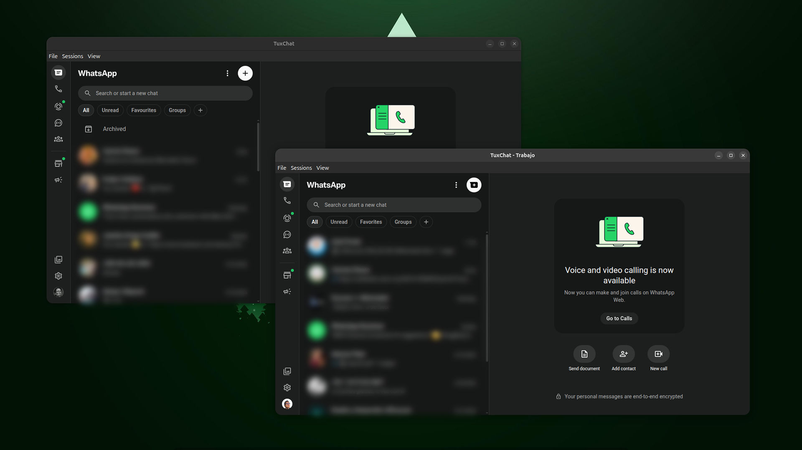
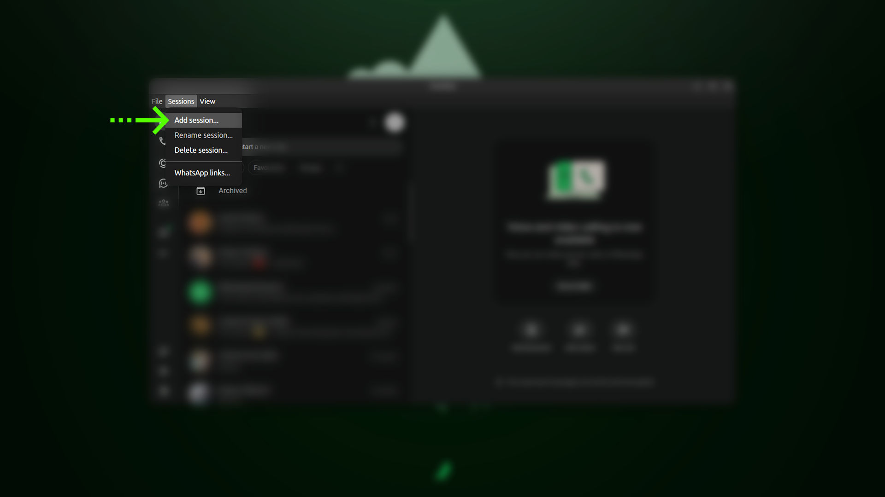
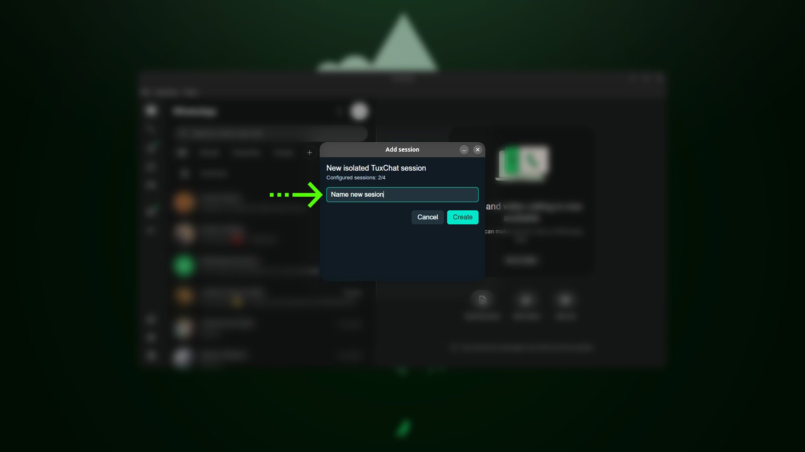
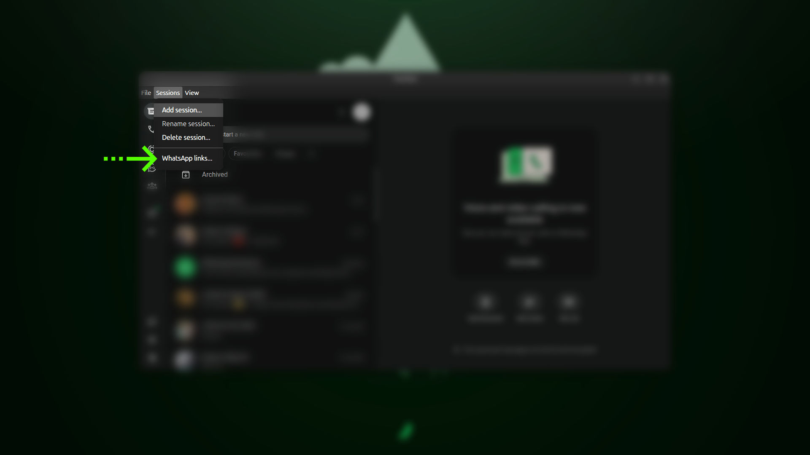
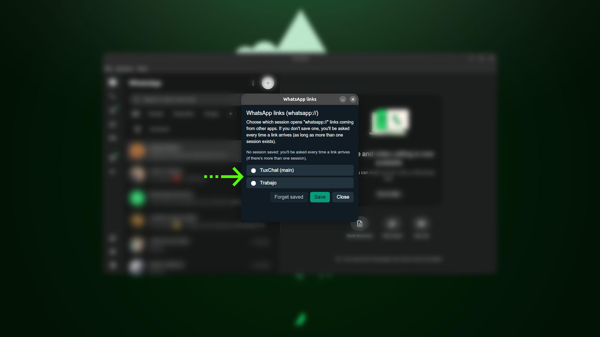

# TuxChat


🇬🇧 [English](README.md) · 🇪🇸 [Español](README.es.md) · 🇧🇷 **Português**

Cliente desktop não oficial do WhatsApp Web para Linux (Electron), com
suporte completo a chamadas de voz/vídeo e compartilhamento de tela,
várias sessões isoladas rodando lado a lado e suporte a links
`whatsapp://`.

**Status: em desenvolvimento inicial (v0.2), ainda não está pronto para uso diário.**

Testado no Ubuntu 26.04 com GPU NVIDIA. Deve funcionar em outras
distros/GPUs (o `.deb` depende apenas de bibliotecas padrão do
GTK/Debian, e `--ozone-platform=x11` só é forçado quando NVIDIA no Wayland
é detectada), mas isso ainda não foi verificado — relatos de outros
ambientes são bem-vindos.

## Capturas de tela



| | |
|---|---|
|  |  |
| **1.** Sessions → Add session… | **2.** Dê um nome à nova sessão isolada |
|  |  |
| **3.** Sessions → WhatsApp links… | **4.** Escolha qual sessão abre os links `whatsapp://` |

## Instalação

Baixe o instalador em
[Releases](https://github.com/histerick/tuxchat/releases):

- **Ubuntu/Debian:** `tuxchat_<version>_amd64.deb` — `sudo apt install ./tuxchat_<version>_amd64.deb`, ou clique duas vezes para abri-lo no instalador de software.
- **Qualquer outra distro:** `TuxChat-<version>.AppImage` — torne-o executável e rode direto. Não precisa instalar, nem de `libfuse2` (distros recentes como o Ubuntu 24.04+ já não o trazem por padrão).

### Atualizações

- **AppImage:** atualiza sozinho, em segundo plano — procura uma nova versão ao abrir e a cada 4 horas enquanto está rodando, baixa sem interromper você e instala na próxima vez que você fechar o app. Ao abrir depois de uma atualização, uma janela única mostra as novidades dessa versão.
- **.deb:** não se atualiza sozinho (quem cuida dele é o `apt`) — baixe o novo pacote em [Releases](https://github.com/histerick/tuxchat/releases) quando sair um.

## Várias sessões

No menu da janela, **Sessões > Adicionar sessão...** cria uma sessão do
WhatsApp totalmente isolada (com login, cache e dados próprios), com seu
próprio ícone e entrada no menu de aplicativos. **Renomear** e **Excluir**
funcionam do mesmo jeito, no mesmo menu.

Cada sessão aparece como um app separado no dock: você pode fixar cada uma
separadamente, e cada uma recebe suas próprias notificações. **Sessões >
Cor da sessão...** dá uma cor à sessão — ela colore a barra de título (um
tom escuro com o tema escuro do sistema, um tom claro com o tema claro) e
o ícone (janela, bandeja e dock) — para você distinguir suas contas num
relance.

## Links do WhatsApp (whatsapp://)

O TuxChat se registra no sistema como o manipulador do esquema
`whatsapp://`, então um link `wa.me/<número>` ou
`whatsapp://send?phone=...&text=...` clicado em qualquer outro app
(navegador, e-mail etc.) abre a conversa direto no TuxChat, em vez de
ficar preso na versão do WhatsApp no navegador. Com mais de uma sessão
configurada, ele pergunta qual usar na primeira vez (com a opção de
lembrar a escolha); isso é gerenciado em **Sessões > Links do
WhatsApp...**.

## Links dentro das conversas

Os links que você recebe numa conversa (Zoom, Google Meet, qualquer
página web) abrem no seu navegador padrão — numa nova aba, se ele já
estiver aberto — em vez de numa janela pop-up do TuxChat. Clique com o
botão direito num link para **Copiar link** e colá-lo onde quiser.

Os links do WhatsApp dentro de uma conversa (`wa.me/<número>`,
`api.whatsapp.com/send`, `whatsapp://`) são a exceção: eles abrem essa
conversa ali mesmo, na mesma sessão, sem passar pelo navegador.

## Desenvolvimento

```bash
npm install
npm start
```

O registro detalhado de desenvolvimento fica fora deste repositório
enquanto o projeto amadurece; veja `tuxchat.md` na máquina de
desenvolvimento.

## Agradecimentos

Agradecimentos a **Pedro Henrique ([@pedruhb](https://github.com/pedruhb))** por identificar e propor a correção do bug de abertura de links do WhatsApp (#1).
